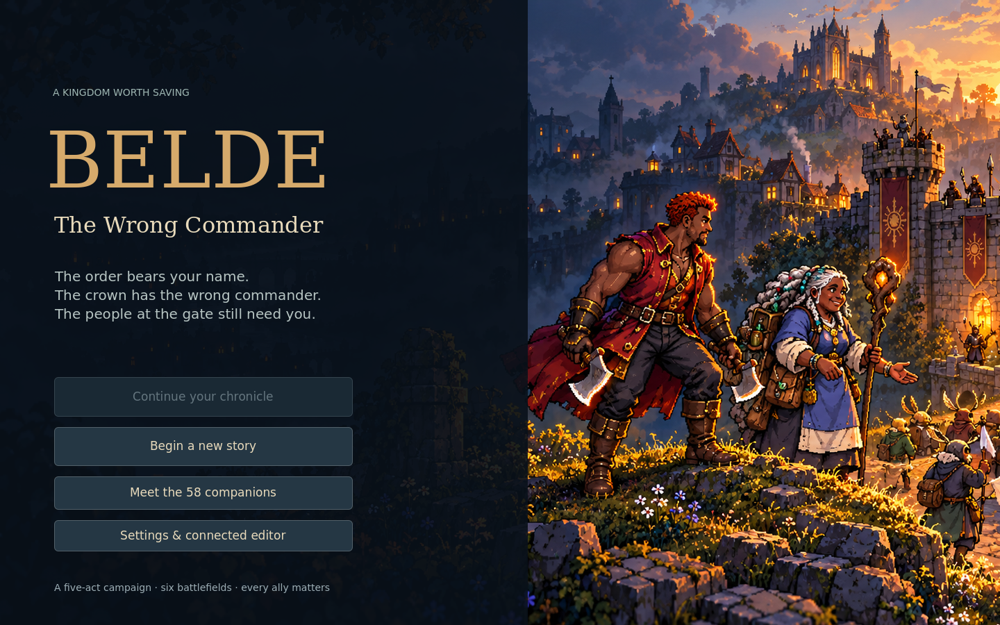

# Belde — The Wrong Commander

A playable Godot 4 tower-defense prototype about a commander sent to the wrong gate—and the people on both sides of it. Recruit a company, build a defense, guide mobile allies along patrol tracks, and carry your survivors through a five-act story.

The desktop game runs on its own. An optional Chrome extension edits the same battlefield through a paired local native-messaging bridge; the game remains authoritative.



## Download and play

Choose the package for your computer. **Extract the entire ZIP before starting the game.** These are development builds, not store releases.

| Computer | Download | Start after extracting |
| --- | --- | --- |
| Windows, x86-64 | [Belde-Windows-x86_64.zip](https://github.com/29leehayoon1-del/Belde/raw/refs/heads/main/dist/Belde-Windows-x86_64.zip) | Open `Belde/Belde.exe`. Keep `Belde.pck` beside it. |
| Linux, x86-64 | [Belde-Linux-x86_64.zip](https://github.com/29leehayoon1-del/Belde/raw/refs/heads/main/dist/Belde-Linux-x86_64.zip) | Run `Belde/Belde.x86_64`. Keep `Belde.pck` beside it. |
| Mac, Apple Silicon | [Belde-macOS-arm64.zip](https://github.com/29leehayoon1-del/Belde/raw/refs/heads/main/dist/Belde-macOS-arm64.zip) | Open `Belde/Belde — The Wrong Commander.app`. |
| Mac, Intel | [Belde-macOS-x86_64.zip](https://github.com/29leehayoon1-del/Belde/raw/refs/heads/main/dist/Belde-macOS-x86_64.zip) | Open `Belde/Belde — The Wrong Commander.app`. |

Godot does not need to be installed to play an exported package. macOS builds are ad-hoc signed and **not Apple-notarized**, so macOS may request approval in Privacy & Security. The Mac's optional browser editor also needs Python 3 for its bundled native-host fallback; the game itself does not.

The Linux package has passed headless title and battle-preview startup checks on Debian 13 x86-64. Windows and Mac exports have been built and structurally checked, but **native execution on Windows/macOS has not been verified**. Checksums and package sizes are recorded in [dist/build-manifest.json](dist/build-manifest.json).

For editable files, download [Belde-Source.zip](https://github.com/29leehayoon1-del/Belde/raw/refs/heads/main/dist/Belde-Source.zip), or clone this repository. Open `game/project.godot` with the official **Godot 4.6.3 standard editor**. See [build instructions](docs/BUILD.md) for dependencies, checks, and exports.

## What is playable

- **58 recruitable characters** across the bar, kingdom, village, capital, prison and five monster generals. Each has an introduction, proposed stats, a portrait, a basic attack and two named abilities with cooldowns.
- **Four classes:** Healer, DPS, Tanker and Strategist. Guard, Patrol and Advance orders support stationary defense and movement while attacking.
- **Six battlefields** with branching enemy roads, separate allied patrol tracks, four tower families, upgrades, three traps, placement previews, collision checks and planning undo/redo.
- **Five story acts:** the mistaken commission, monster surrender and negotiation, a rescue and siege, reinforcement choices, and Avarren's last stand. Casualties and choices affect the surviving company and ending.
- A final choice between forgiveness with reparations and refusal of pardon with a public hearing. Defeat has recovery and evacuation paths.
- Versioned local campaign saves with a backup, plus pause, speed and sound settings.
- A title system based on **2,000 authored candidate combinations**, with eligible parts filtered by the run's actual choices. This means combinations of title text and ending verses, not 2,000 separately painted endings.

Begin at the bar, kingdom or village and choose two allies. Place defenses, then press **Space** to call the next wave. Select an ally and use **1** / **2** for abilities; drag allies to reposition during planning. **Esc** opens pause and **F5** saves. Full controls and campaign rules are in [Gameplay](docs/GAMEPLAY.md).

For a tested opening, recruit **Cael Sunmere and Sister Lysenne Vale** at the kingdom. The [combat audit](docs/COMBAT-AUDIT.md) records a legal defense that wins both opening battles with both allies alive, including its tower, trap and placement choices.

## Connected Chrome editor

The desktop packages include `extension/` and `native/`:

1. In Chrome, open `chrome://extensions`, enable Developer mode, and load the bundled `extension/` folder unpacked.
2. Follow the [native-host installation instructions](native/README.md) for your operating system.
3. Start the game, open its connected-editor panel, and enter the displayed pairing code in the extension.
4. Use **Open full editor** for the larger map-editing window.

Edits share the game's layout revision, economy and validation. Planning changes apply immediately; combat layout edits queue for a safe phase. A second local game or editor is rejected, and abandoned editor leases expire. Cross-device profile enforcement requires the optional self-hosted [profile coordinator](native/session-README.md); no hosted account service has been deployed.

The actual bridge/native transports and editor code have automated checks. Full unpacked-extension installation in the cloud browser is **skipped because managed Chromium policy blocks it**. That browser installation must still be checked on a normal supported desktop. See the [extension guide](extension/README.md) for the precise tested scope.

## Artwork and prototype limits

The runtime uses original transparent gameplay pose atlases for **67 actors**: 58 recruits and nine enemy/boss models. They have eight indexed pose/effect slots per actor, with two alternating walk contacts, a run pose, attacks, abilities, and downed/surrender references. Six scenic backgrounds and the menu illustration are also supplied.

These are **prototype key poses, not finished full-frame, eight-direction animation packs**. The current rendering uses a canonical three-quarter view, limited pose alternation and mirrored facing. Some cell-edge contacts, weapon consistency, effect-only cells and release/recovery transitions still need an artist's pass. Towers, tracks, projectiles and tactical effects also use simplified runtime drawing. See [Art Review](docs/ART-REVIEW.md) for exact coverage and known limits.

Combat numbers are implemented starting budgets with automated scenario checks, not proof of final balance. The [combat audit](docs/COMBAT-AUDIT.md) records actual encounter outcomes and the tested boss strategy. The campaign's roughly half-hour pace varies with recruitment, planning, optional battles, losses and game speed. A full human playtest and platform testing remain part of production.

The earlier [visual artbook](preproduction/README.md) remains a separate design reference. Download the [visual-preproduction ZIP](https://github.com/29leehayoon1-del/Belde/raw/refs/heads/main/dist/Belde-Visual-Preproduction.zip), extract it fully, and open `preproduction/index.html`; GitHub's normal file viewer displays HTML source rather than running the artbook.

## Development and validation

On the prepared Linux development environment:

```sh
source tools/runtime_env.sh
godot --headless --editor --path game --quit
python tools/run_checks.py
```

The checks exercise campaign branches and rosters, combat and save/restore, UI scene callbacks, native framing, the live Godot bridge and the optional profile coordinator. Some editor tests explicitly adapt or mock Chrome's Port API; those do not substitute for a real installed-extension test. Build/package checks validate ZIP contents, checksums and executable architectures, without claiming execution on another operating system.

[docs/BUILD.md](docs/BUILD.md) describes reproducing prerequisites and exports. Godot's license and third-party notices accompany the desktop packages; original game content is maintained in this repository.
